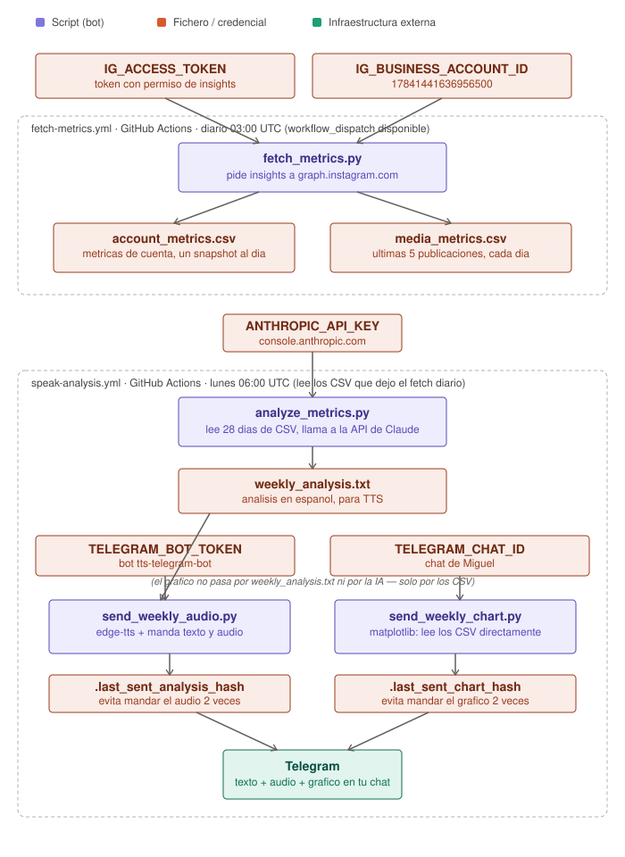

# Bot de metricas de Instagram

## Objetivo

Cada dia, pide a la Graph API de Instagram las metricas de tu cuenta
(alcance, visitas al perfil, interacciones...) y de tus publicaciones
recientes (alcance, likes, comentarios, guardados...), y las guarda en dos
CSV dentro de este mismo repo — un snapshot diario, para poder ver el
comportamiento dia a dia y no solo una foto semanal. Con ese historico,
Claude (o cualquier otra herramienta) puede leer la evolucion en el tiempo y
darte analisis y consejos sin tener que llamar a la API cada vez que
preguntes. El reporte (analisis hablado + grafico) se sigue mandando una vez
a la semana — ver "Analisis semanal por audio e imagen" mas abajo.

Es un proyecto independiente del bot de publicacion (`automatizacion-instagram`)
a proposito, aunque los dos hablan con la misma cuenta de Instagram — asi cada
uno tiene su propio repo, su propio cron y sus propios secrets, y un fallo en
uno no afecta al otro.

## Esquema



## Arquitectura

**Entorno:** GitHub Actions (gratuito, sin mantenimiento, no depende de que
tengas el ordenador encendido) — igual que el bot de publicacion.

**Frecuencia:** cron diario, 03:00 UTC (`.github/workflows/fetch-metrics.yml`)
para la recogida de metricas — antes era semanal, se cambio a diario para que
los datos reflejen el comportamiento dia a dia de la cuenta. El reporte
(analisis + audio + grafico) se sigue mandando una vez a la semana, lunes
06:00 UTC (`.github/workflows/speak-analysis.yml`) — ver "Analisis semanal
por audio e imagen" mas abajo. Puedes cambiar cualquiera de los dos crons o
lanzarlos a mano desde la pestana Actions de GitHub (`workflow_dispatch`).

**Datos guardados:**
- `account_metrics.csv` — una fila por metrica de cuenta y ejecucion (alcance,
  visitas al perfil, cuentas alcanzadas, interacciones totales, clics a la
  web, seguidores), un snapshot por dia.
- `media_metrics.csv` — una fila por metrica y publicacion, de las
  `MEDIA_RECENT_COUNT` publicaciones mas recientes (por defecto 5; antes eran
  TODAS las de los ultimos 90 dias, pero eso corria una vez por semana — con
  el fetch ahora a diario, mantener la ventana de 90 dias multiplicaria por
  ~7 las filas guardadas y las llamadas a la API de Meta, asi que se paso a
  un numero fijo de publicaciones por ejecucion). Como se vuelve a pedir cada
  dia para las mismas publicaciones recientes, puedes ver como evoluciona un
  post con el tiempo, no solo su valor final.

Ambos CSV son de solo-anadir (append-only), igual que `published_log.csv` del
otro bot, y tienen `merge=union` en `.gitattributes` para que nunca haya
conflictos de git si se ejecuta mas de una vez seguida.

## Estado (2026-10-21)

Todo funcionando de punta a punta en GitHub Actions: recogida diaria, analisis
con la API de Claude, audio y grafico por Telegram.

- **Token de Instagram:** caduco el 2026-10-01 y la recogida fallo 20 dias sin
  avisar. Desde el 2026-10-21 `renew-token.yml` lo renueva cada domingo (cada
  renovacion dura 60 dias) y lo guarda en este repo y en
  `automatizacion-instagram`, usando el secret `GH_PAT` (token personal de
  GitHub con permiso de escribir Secrets en esos dos repos; **tambien caduca**).
  Si caduca igualmente: nuevo token en developers.facebook.com → app → Casos
  de uso → "Administrar mensajes y contenido en Instagram" → "Configuracion de
  la API con inicio de sesion de empresas de Instagram" → "2. Genera
  identificadores de acceso" → "Generar identificador". Guardarlo SIN pegarlo
  en el prompt de `gh` (kitty lo corrompe): copiarlo y
  `wl-paste -n | gh secret set IG_ACCESS_TOKEN -R noobiedeviedoo/<repo>`.
- **Avisos:** `fetch-metrics.yml` y `renew-token.yml` mandan un Telegram si fallan.
- **Metricas de cuenta:** alcance, visualizaciones, reposts, cuentas que
  interactuan, interacciones, visitas al perfil (`profile_views`), clics al
  enlace de la web (`website_clicks`) y seguidores ganados/perdidos
  (`follows`/`unfollows`, de `follows_and_unfollows` con `breakdown=follow_type`).
  Pese a lo que decia una version anterior, `profile_views` y `website_clicks`
  SI funcionan con este acceso (probado en vivo).
- **Formato de cada publicacion:** `media_info.csv` (reel, carrusel, foto,
  video), se reescribe entero en cada recogida.
- **Huecos:** `backfill.yml` (manual, primero en modo prueba) rellena dias sin
  datos o metricas nuevas hacia atras; Instagram guarda unos 30 dias. Se uso
  para el 2026-10-02 → 10-19. Seguidores y n.º de publicaciones no se pueden
  recuperar hacia atras.
- **Grafico semanal** (`send_weekly_chart.py`): cifras de la semana con su
  cambio, fila "del perfil a tu negocio" (incluye las visitas a la web que
  llegan desde Instagram, leidas del repo publico `web-metrics-vercel`), un
  minigrafico por metrica de las ultimas 4 semanas y los posts de los ultimos
  14 dias frente a la mediana. Probar en local sin mandar nada:
  `SOLO_IMAGEN=/tmp/g.png python scripts/send_weekly_chart.py`.
- **Analisis** (`analyze_metrics.py`): Python calcula las comparaciones y
  Claude recibe solo esas cifras y el informe anterior; estructura fija
  (titular, que ha cambiado, una recomendacion) y muletillas prohibidas. Ver
  el prompt sin llamar a la API: `ANTHROPIC_API_KEY=x SOLO_PROMPT=1 python
  scripts/analyze_metrics.py`.
- Los repos de metricas son **publicos a proposito**: Actions es gratis sin
  limite en repos publicos.

**Nota sobre una vuelta atras:** la primera version de esto usaba una tarea
programada de Cowork para que Claude escribiera el analisis. Se descarto:
esas tareas solo corren si tienes la app de Cowork abierta en ese momento, y
si no, se posponen a cuando la abras — eso rompia la idea de que todo el
bot funcione sin depender de tu ordenador. Ahora el analisis lo pide
directamente `analyze_metrics.py` a la API de Claude, dentro del mismo run
de GitHub Actions — sin Cowork de por medio para nada del flujo semanal.

## Puesta en marcha (pasos que tienes que hacer tu)

### 1. Crear el repositorio en GitHub

Esta carpeta ya tiene `git init` hecho localmente. Crea un repositorio vacio
en GitHub (puede ser privado) y anade el remoto:

```
git remote add origin <URL-de-tu-repo>
git branch -M main
git push -u origin main
```

### 2. Dar permiso de insights al token

El token que ya usas para publicar (en `token facebook app.txt`, carpeta
`BOTS`) se genero solo con permiso de publicar. Para leer metricas hace falta
ademas:

- `instagram_business_basic`
- `instagram_business_manage_insights`

Ve a tu app en [developers.facebook.com](https://developers.facebook.com/),
revisa los permisos concedidos al token de tu cuenta de Instagram y anade
esos dos si no los tiene, o genera un token nuevo que ya los incluya. Puedes
usar el mismo token para los dos bots (publicar y metricas) o uno distinto
para cada uno — como prefieras.

### 3. Configurar los Secrets del repo

En GitHub: **Settings → Secrets and variables → Actions → New repository
secret**. Anade:

- `IG_ACCESS_TOKEN`
- `IG_BUSINESS_ACCOUNT_ID` (el mismo ID que usas en el otro bot: `17841441636956500`)

### 4. Primera ejecucion manual

Pestana **Actions** del repo → **Recoger metricas de Instagram (programado)**
→ **Run workflow**. Revisa el log como se explica arriba.

## Analisis semanal por audio e imagen (Telegram)

Ademas de guardar los datos, cada semana se analizan de verdad (llamando a la
API de Claude, no una plantilla de numeros fija) y el resultado te llega en
tres mensajes a tu bot de Telegram de texto-a-voz (`tts-telegram-bot`): el
texto del analisis, el audio del mismo texto, y un grafico con la evolucion
de seguidores y las publicaciones con mas alcance. Todo el flujo vive en
GitHub Actions — no depende de que tengas Cowork ni el ordenador encendidos:

1. **`fetch-metrics.yml`** (diario, 03:00 UTC) corre un solo script:
   - `fetch_metrics.py` — actualiza `account_metrics.csv` (un snapshot mas de
     cuenta) y `media_metrics.csv` (insights de las publicaciones mas
     recientes), y comitea los dos CSV. Ya NO llama a la API de Claude en
     este paso — eso se movio a `speak-analysis.yml` (ver mas abajo), para
     que el analisis se genere una vez por semana y no se gaste una llamada a
     la API cada dia.
2. **`speak-analysis.yml`** (lunes 06:00 UTC, tres horas de margen sobre el
   fetch de ese mismo dia) corre tres scripts seguidos:
   - `analyze_metrics.py` — le pasa los CSV (que ya traen hasta 28 dias de
     snapshots diarios) a la API de Claude (Messages API) y guarda la
     respuesta en `weekly_analysis.txt`. Si este paso falla (p.ej. la API de
     Anthropic caida), no bloquea los pasos siguientes — se marca como
     fallido en el log, y como el texto no cambio, el audio de ese dia
     simplemente no se manda (ver hash mas abajo).
   - `send_weekly_audio.py` — lee `weekly_analysis.txt`, genera el audio con
     `edge-tts` (la misma libreria que usa `tts-telegram-bot`) y manda texto +
     audio por Telegram. Solo manda si el texto cambio desde el ultimo envio
     (hash en `.last_sent_analysis_hash`), asi que ejecutarlo dos veces
     seguidas no te duplica el mensaje.
   - `send_weekly_chart.py` — con `matplotlib`, dibuja dos paneles a partir de
     los CSV (sin llamar a ninguna API, y sin pasar por `analyze_metrics.py`).
     El primero es la "Tendencia semanal": un punto por dia con 4 lineas —
     tasa de interaccion (%, eje izquierdo, valor real) y seguidores /
     alcance / reproducciones-por-alcance (eje derecho, INDEXADAS a 100 sobre
     el primer dato, porque son cifras en escalas muy distintas entre si y lo
     que importa es cuanto sube o baja cada una, no su valor absoluto). El
     segundo panel: las publicaciones con mas alcance ahora mismo (top 8).
     Con el fetch ahora a diario, este panel gana un punto nuevo cada dia en
     vez de uno por semana, asi que se vuelve util mucho antes. Mismo patron
     anti-duplicados que el audio, con su propio hash en
     `.last_sent_chart_hash` (los datos del grafico pueden cambiar en una
     semana en la que el texto no cambie, o al reves). Si este paso falla no
     bloquea el commit de los marcadores (`continue-on-error`).
   - Al final se comitean juntos `weekly_analysis.txt` (si cambio) y los
     hashes `.last_sent_analysis_hash` / `.last_sent_chart_hash`.

Por que en dos workflows y no uno: son responsabilidades distintas (recoger
datos a diario vs. analizar + convertir a voz + avisar una vez por semana), y
separarlos permite que uno falle sin tumbar al otro, ademas de que el fetch
diario no dependa de la API de Claude ni de Telegram para nada.

### Secrets nuevos para este paso

Ademas de `IG_ACCESS_TOKEN` e `IG_BUSINESS_ACCOUNT_ID`, anade en
**Settings → Secrets and variables → Actions**:

- `ANTHROPIC_API_KEY` — creala en [console.anthropic.com](https://console.anthropic.com/settings/keys).
  Coste: una llamada semanal a un par de CSV pequeños, del orden de centimos
  al mes con el modelo por defecto (`claude-sonnet-5` — cambialo con la
  variable `ANTHROPIC_MODEL` en el workflow si prefieres uno mas barato).
- `TELEGRAM_BOT_TOKEN` — el token de tu bot `tts-telegram-bot` (el mismo que
  tienes en `BOTS/tts-telegram-bot/.env`).
- `TELEGRAM_CHAT_ID` — tu chat_id de Telegram.

**Aviso de seguridad:** ese mismo token de Telegram esta ahora mismo escrito
en texto plano en `BOTS/tts-telegram-bot/.env`. No pasa nada mientras esa
carpeta no sea un repo de git publico (ya se quito la copia que habia
tambien en su README).

## ¿Y si quiero pedirte un analisis fuera de la rutina semanal?

Puedo leer `account_metrics.csv` y `media_metrics.csv` cuando quieras, en
cualquier conversacion normal con Claude, y darte un analisis al momento —
no hace falta esperar al lunes ni tocar la API por separado.

## Sobre el token de GitHub que le diste a Claude

Ese *fine-grained PAT* (solo este repo, permiso `Contents: Read and write`)
ya no hace falta para el flujo semanal — con el rediseño de arriba, todo lo
recurrente corre dentro de GitHub Actions usando su propio token integrado,
sin que Claude necesite tocar el repo entre semana. Sigue siendo util para
que Claude pueda hacer cambios puntuales (como los de hoy) sin pedirte que
copies y pegues comandos de git constantemente, asi que puedes dejarlo activo
si te viene bien — o revocarlo desde GitHub cuando quieras, no rompe nada de
lo automatico.

## Estructura del repo

```
instagram-metrics-bot/
├── scripts/
│   ├── fetch_metrics.py         # Pide insights y los anade a los CSV; reescribe media_info.csv
│   ├── backfill_account.py      # Rellena huecos de account_metrics.csv (lo lanza backfill.yml)
│   ├── analyze_metrics.py       # Calcula las cifras de la semana, se las pasa a Claude y escribe weekly_analysis.txt
│   ├── send_weekly_audio.py     # Convierte weekly_analysis.txt a audio y manda texto + audio
│   └── send_weekly_chart.py     # Dibuja el resumen semanal a partir de los CSV y manda la imagen
├── .github/workflows/
│   ├── fetch-metrics.yml        # Cron diario: solo actualiza los CSV (avisa por Telegram si falla)
│   ├── speak-analysis.yml       # Cron semanal (lunes): genera el analisis y manda audio + grafico
│   ├── renew-token.yml          # Cron semanal (domingo): renueva el token de Instagram en los dos bots
│   └── backfill.yml             # Manual: rellenar huecos de metricas de cuenta
├── docs/
│   └── esquema-bot.svg          # Diagrama del flujo completo (ver "Esquema" arriba)
├── account_metrics.csv          # Se crea solo en la primera ejecucion
├── media_metrics.csv            # Se crea solo en la primera ejecucion
├── media_info.csv               # Catalogo de publicaciones con su formato
├── weekly_analysis.txt          # Lo escribe analyze_metrics.py cada semana
├── .last_sent_analysis_hash     # Lo escribe speak-analysis.yml, evita duplicar el audio
├── .last_sent_chart_hash        # Lo escribe speak-analysis.yml, evita duplicar el grafico
├── requirements.txt
├── .env.example
├── .gitattributes
└── .gitignore
```
